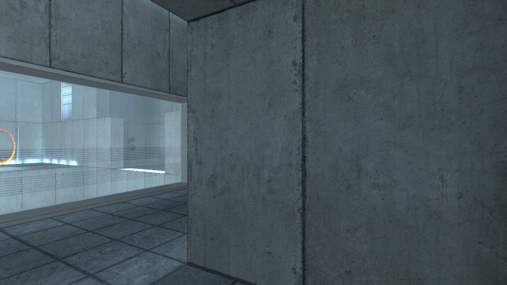

# Portal for Apple Silicon

Build and play the original **Portal (2007)** on an Apple Silicon Mac using your own Steam installation.

This installer builds a community engine locally, packages it as **Portal Native.app**, and can connect that app to Steam's **Play** button. It includes the SDL3 runtime needed by current SDL2-compat packages and fixes dynamic library paths inside the app.



**This repository contains installer code and documentation only.** You must own Portal on Steam. Game data, engine source, and compiled engine binaries are not included. The resulting app contains your game files; do not upload or redistribute it.

## Tested setup

| Component | Tested value |
| --- | --- |
| Hardware | Apple M1, 8 GB RAM |
| System | macOS 26.2 |
| Developer tools | Xcode 26.6, Python 3.14.7 |
| Game | Portal, App ID `400` |
| Steam branch | `beta` — SteamPipe Beta |
| Steam build | `13095453` |
| Content depot | `401`, manifest `3566636281151658894` |
| Engine revision | [`ed8209cc35c61fbd8ddff8480962a01c981eef2f`](https://github.com/nillerusr/source-engine/tree/ed8209cc35c61fbd8ddff8480962a01c981eef2f) |

The native engine was tested by loading a playable test chamber and inspecting its rendered output. Steam launching was also checked. This is not a complete playthrough or a guarantee for every Mac, macOS release, or mod. Intel Macs, Portal 2, and Portal with RTX are outside this project's scope.

## 1. Prepare Portal in Steam

1. Install **Portal** in the macOS Steam client.
2. Open **Library → Portal → Properties → Betas**.
3. Select **beta — SteamPipe Beta** and wait for the update to finish.
4. Close Portal before running the installer.

The normal public branch has newer assets that can produce shader errors, missing surfaces, or a black screen with this engine. The installer checks the exact tested content manifest and stops if it does not match. If Valve changes the beta branch, it may be necessary to update this project before installing again.

You do not need to give this installer your Steam username, password, or Steam Guard code. Steam downloads the game through its normal client.

## 2. Install prerequisites

Use a native Apple Silicon terminal, not a terminal running under Rosetta. `uname -m` should print `arm64`.

Install Apple's command line developer tools if needed:

```sh
xcode-select --install
```

Install [Homebrew](https://brew.sh/) if you do not already have it, then install the build dependencies:

```sh
brew install python sdl2 freetype fontconfig pkg-config jpeg-turbo libpng
```

Current Homebrew may resolve `sdl2` to **sdl2-compat**, which depends on SDL3. The installer detects this and bundles SDL3 as well. Python 3.9 or newer is required. Have about **10 GB of free disk space** available for source, build output, and a separate game app. The installer does not install Homebrew, developer tools, or packages automatically.

## 3. Build the app

```sh
git clone https://github.com/ShikiYuriSan/portal-macos-installer.git
cd portal-macos-installer
python3 install.py --check
python3 install.py
```

The build takes several minutes; an initial local engine build took about seven minutes on the tested M1. Download speed and compiler versions can affect the total time.

When finished, open **Finder → Go → Home → Applications → Portal Native.app**, or run:

```sh
open "$HOME/Applications/Portal Native.app"
```

The default install creates a separate app and preserves the original Steam installation. It refuses to replace an existing app. Move your existing native app aside, or choose a different `--app` path when rebuilding. Keep any saves you want before removing an older app.

### Other Steam libraries or destinations

Pass the **Portal game folder**, not the Steam library root:

```sh
python3 install.py \
  --game-dir "/Volumes/Games/SteamLibrary/steamapps/common/Portal" \
  --app "$HOME/Applications/Portal Native.app" \
  --work-dir "$HOME/Library/Caches/portal-macos-build" \
  --jobs 4
```

The build folder, game folder, and destination app must be separate. Lower `--jobs` if compilation uses too much memory. Completed downloads and build files remain in `.build/` by default, so an interrupted compilation can be retried. If packaging was interrupted and a staging `.app` remains, move it aside or choose a fresh `--work-dir`.

## Optional: launch from Steam

After building, close Portal and run:

```sh
python3 install.py --link-steam
```

This saves the original `hl2_osx` launcher as `hl2_osx.portal-macos-installer-backup`, then replaces the launcher with a small script pointing to your native app. It does not replace Steam's game data. For custom locations, include the same `--game-dir` and `--app` options you used when building.

To restore the saved Steam launcher:

```sh
python3 install.py --unlink-steam
```

For a custom library, include `--game-dir` when restoring. The restore command refuses to overwrite a launcher that has been modified by another tool or by Steam. In that case, use Steam's **Verify integrity of game files** to restore the official launcher.

Steam updates or file verification can undo the launcher link. Run `--link-steam` again after restoring/removing an obsolete backup, or launch **Portal Native.app** directly. Keep the app at its linked path, or relink after moving it.

The native app has its own copied game data and saves. Steam launching does **not** establish Steam Cloud synchronization or guarantee Steam achievements, overlay, or other Steamworks features.

## Saves, cleanup, and uninstall

- Native saves are inside `Portal Native.app/Contents/Resources/portal/save/`. In Finder, right-click the app and choose **Show Package Contents** to access them.
- Existing saves present in the Steam game folder at build time are copied with the game data. Later changes are not automatically synchronized between the two installations.
- After a successful installation, you can remove the build cache (`.build/` or your custom `--work-dir`). Keep the installed `.app`.
- To uninstall, first restore the Steam launcher if linked, back up your native saves, then move **Portal Native.app** to the Trash. The installer does not change your Steam beta selection; you can return to the normal branch in Steam yourself.

## Troubleshooting

**Black screen or broken world textures:** Confirm you selected **SteamPipe Beta**, let Steam finish downloading, and run `python3 install.py --check`. An existing native app contains a snapshot of the old game data; changing Steam's branch does not update that app. Rebuild to a new app path after fixing the content version.

**“Failed loading SDL3 library”:** Run `brew install sdl3`, then rebuild to a new app path. The packager includes the library that SDL2-compat loads dynamically.

**“Bad CPU type in executable”:** You are likely launching the original 32-bit Mac executable. Open **Portal Native.app** directly or run `--link-steam` after building it.

**Compiler or dependency errors:** Confirm `uname -m` reports `arm64`, `brew --prefix` reports `/opt/homebrew`, and `xcrun --sdk macosx --show-sdk-path` succeeds. Install the dependencies above. The engine revision is pinned, but Homebrew and Xcode versions are not; future compiler changes may require installer updates.

**macOS security prompts:** This is a locally built app with ad-hoc signed native binaries, not an Apple-notarized distribution. This installer does not disable Gatekeeper or alter system security settings. Consult [Apple's guidance on opening apps](https://support.apple.com/102445) if macOS blocks an app you have built and trust.

If you report an issue, include the macOS version, chip, `python3 --version`, `xcodebuild -version` (or command line tools version), and the relevant error lines. Remove personal paths and account details from logs first.

## Development

The installer uses Python's standard library. Run its portable checks with:

```sh
python3 -m unittest discover -s tests -v
python3 -m py_compile install.py
```

CI checks prerequisite validation and reversible Steam launcher behavior using temporary fixtures. On Apple Silicon, the test suite also compiles a tiny native fixture to verify that SDL2's dynamically loaded SDL3 dependency is bundled and still works after the original libraries are removed. That native test is skipped on Linux CI. Tests do not download Portal or test gameplay. A real installation requires an owned Steam copy and a Mac.

## Credits and licensing

- [nillerusr/source-engine](https://github.com/nillerusr/source-engine) provides the community engine. Its README describes its source as based on leaked Valve code. It is not an official Valve release; review that repository and its licensing before choosing to build it.
- [nonoche2/Portal-patcher](https://github.com/nonoche2/Portal-patcher) documents the compatible Portal content version and the modern macOS build approach that informed this installer.
- Portal and Source are Valve properties. This project is not affiliated with or endorsed by Valve.

The **original installer code and documentation in this repository** are available under the [MIT License](LICENSE). This license does not apply to Valve game content, upstream engine code, the gameplay screenshot, or third-party libraries. Upstream license files and legal notices are copied into the locally built app under `Contents/Resources/Engine Notices/`. Nothing here grants redistribution rights to the generated game app.
